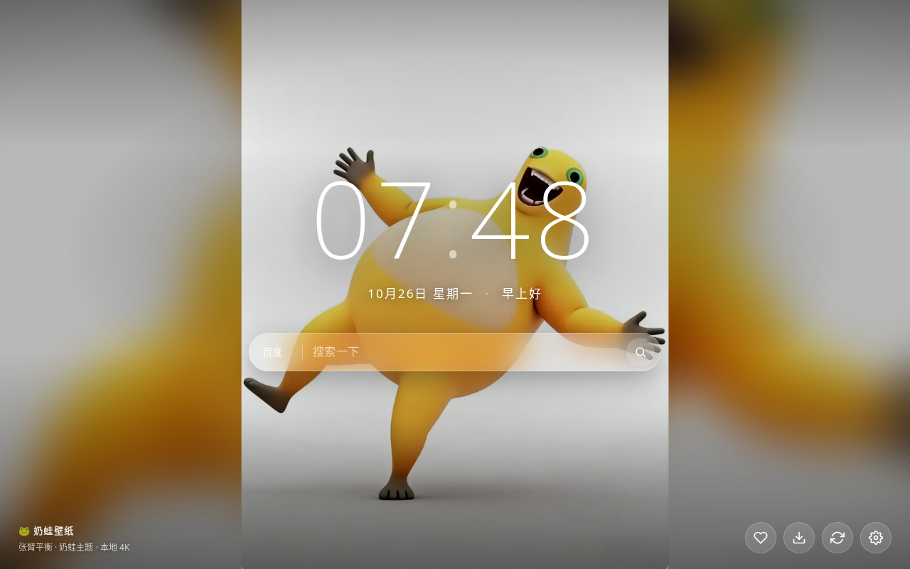
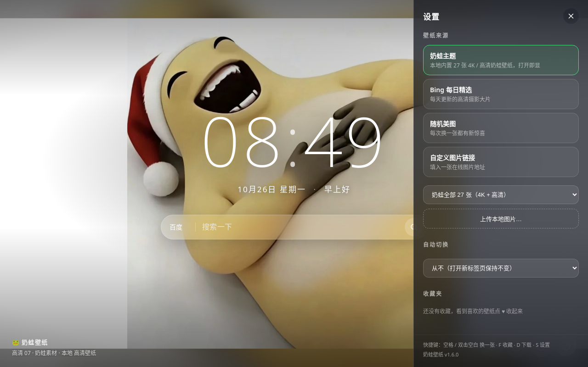

# 🐸 奶蛙壁纸 · 浏览器新标签页插件

> **本扩展的唯一职责，是在你每次打开新标签页、准备逃避工作的那一秒，递上一只奶蛙。**
>
> 它不分析你的行为，不上传你的数据，不推荐理财产品。
> 它只负责显示时间、显示壁纸、显示一只笑得很有分寸的蛙。

把浏览器新标签页改造成每日壁纸：大时钟、问候语、聚合搜索，一键收藏与下载。默认主题为内置的「奶蛙」图包，打开即显、离线可用——网络断了，快乐不断供。

> 本仓库是 **Nailong-Studio** 组织下的官方壁纸扩展。
> 素材统一由素材仓库 **[Nailong-Studio/NaiWa-Wallpaper](https://github.com/Nailong-Studio/NaiWa-Wallpaper)** 供货（`4k/` 与 `hd/`），
> 中文语义命名 + 同名 `.txt` 档案。想换图或提新图，去库房办手续，不要在这里私自动工。





## 一、功能编制

- **壁纸来源**（设置面板内切换）
  - 奶蛙主题（默认）：内置 212 张奶蛙壁纸（桌面横屏 73 / 手机竖屏 75 / 方形大图 35 / 4K 巨幕 5 / 姿势壁纸 24），开屏即显、随机换图，不依赖网络
  - 奶蛙分类：全部 / 桌面横屏 / 手机竖屏 / 方形大图 / 4K 巨幕 / 姿势壁纸，按需供奉
  - Bing 每日精选：自动获取最近数日的 Bing 高清壁纸，每天自动换新
  - 随机美图：从 Picsum 图库随机抽取，附带摄影师署名，不侵犯他人署名权
  - 自定义图片链接 / 上传本地图片
- **收藏夹**：看到喜欢的点 ♥，随时回看、一键应用。收藏是私人行为，不上报。
- **下载壁纸**：一键保存当前壁纸为 jpg，用于桌面、群聊或打印裱框。
- **自动切换**：按半小时 / 小时 / 天轮换，打开新标签页时生效。你不在时它不换，避免浪费。
- **时钟与搜索**：大时钟 + 问候语，搜索框支持 百度 / 必应 / Google。
- **视觉与动效**：壁纸完整显示（Contain）+ 同图模糊垫底，任何窗口比例都不裁切主体；Ken Burns 呼吸缩放、时钟冒号呼吸、翻分钟、换一张旋转、收藏心跳、分层入场。动效均为克制型，不制造眩晕。
- **响应式**：窄窗、矮窗自动缩放；设置面板小屏全宽。
- **离线兜底**：网络不可用时自动退到内置渐变壁纸，新标签页永不空白。
- **快捷键**：`空格` 或 `双击空白处` 换一张 · `F` 收藏 · `D` 下载 · `S` 设置 · `Esc` 关闭面板。
- **其它**：一键恢复默认设置；浅色壁纸下自动加中央遮罩，保证时钟清晰可读。

## 二、安装（Chrome / Edge，无需打包）

1. 直接下载安装包 **[naiwa-wallpaper-v1.7.1.zip](https://github.com/Nailong-Studio/NaiWa-NewTab/releases/latest)**（或在 [在线预览页](https://naiwa-wallpaper.pages.dev/) 右下角点「下载扩展」），解压到任意目录；压缩包根目录就是 `manifest.json`，解压后直接选该目录即可
2. 打开浏览器，地址栏输入 `chrome://extensions`（Edge 为 `edge://extensions`）
3. 打开右上角（Edge 为左侧栏）的 **「开发者模式」** 开关
4. 点击 **「加载已解压的扩展程序」**，选择解压后的扩展目录（仓库根目录即扩展本体）
5. 浏览器可能提示「更改新标签页」，确认保留
6. 新开一个标签页，验收奶蛙 🐸

> **主站**：<https://naiwa-wallpaper.pages.dev/> —— 在线预览与安装包下载以此为准（GitHub 仅存源）。
>
> 不想安装？[在线预览](https://naiwa-wallpaper.pages.dev/) 提供同款新标签页，功能一致，只是不接管浏览器。

## 三、仓库编制

本仓库根目录就是扩展本体（`chrome://extensions` 里直接选这个文件夹）：

```
.
├── manifest.json        # 扩展清单（Manifest V3）
├── newtab.html          # 新标签页入口
├── css/newtab.css       # 样式
├── js/
│   ├── storage.js       # 存储适配层（chrome.storage / localStorage）
│   ├── sources.js       # 壁纸数据源（奶蛙内置包 / Bing / Picsum / 离线渐变）
│   └── newtab.js        # 主逻辑（调度、收藏、设置、交互）
├── wallpapers/          # 212 张奶蛙壁纸 + thumbs/ 缩略图 + list.json
└── icons/               # 插件图标 16/48/128
```

`wallpapers/` 中的文件来自素材仓库 [wallpaper](https://github.com/Nailong-Studio/NaiWa-Wallpaper)：`classic/`、`hd/`、`4k/`、`art/`、`frames/`、`emotes/`、`laugh-gallery/`、`mobile/`、`poses-wall/`。

`wallpapers/list.json` 记录每张图的 `file` / `thumb` / `title` / `category` / 尺寸。换图只需同步素材仓库对应文件，再重新生成清单。插件不自行生产素材，只负责陈列。

`category` 取值：`desktop`（横屏 ≥1.5:1）、`vertical`（竖屏 ≤0.72:1）、`square`（近方形）、`4k`、`poses`（3D 立绘合成的竖屏壁纸）。

## 四、数据与隐私

- 壁纸缓存、收藏、设置全部保存在本地（`chrome.storage.local`），不上传任何数据。
- 网络请求仅访问 Bing 壁纸接口（`cn.bing.com`）与 Picsum 图库（`picsum.photos`）。
- 奶蛙主题图随扩展打包，本地读取，不发任何请求。
- 本扩展不读取网页内容、不注入页面、不统计你打开了多少次新标签页。它对此不感兴趣。

## 五、相关仓库

| 仓库 | 内容 |
|---|---|
| [Nailong-Studio/NaiWa-Wallpaper](https://github.com/Nailong-Studio/NaiWa-Wallpaper) | 官方素材库房：全部奶蛙馆藏与 4K 大图 |
| [Nailong-Studio/NaiLoong-Universe](https://github.com/Nailong-Studio/NaiLoong-Universe) | 奶蛙艺术圣殿 · 沉浸式线上艺术馆 |

## 六、已知说明

- 首次安装后 Bing 每日精选需联网拉取一次列表；失败会自动退到随机美图或渐变壁纸，不会让你对着空白页发呆。
- 「上传本地图片」以 DataURL 形式存于本地存储；图片过大（>10MB）时加载会稍慢，属于正常的物理规律。

## License

MIT
