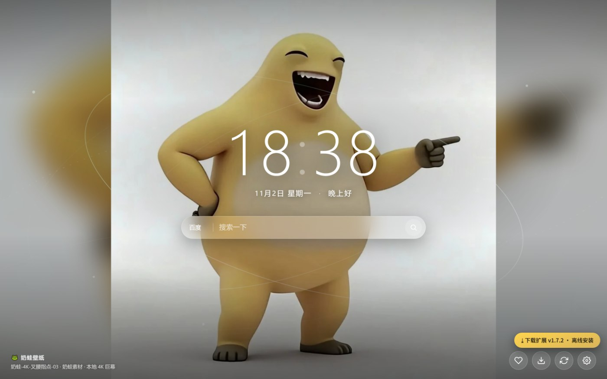
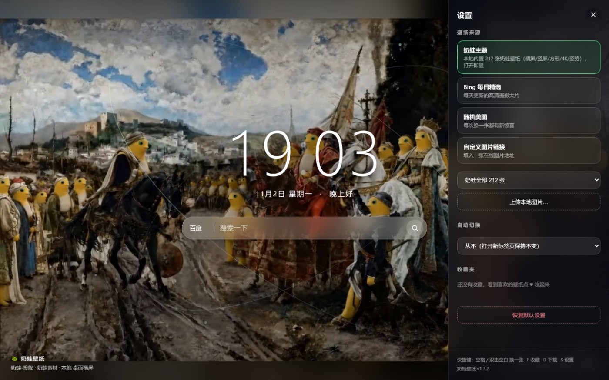

<div align="center">

# NaiWa New Tab

**Every new tab, a different frog. 212 wallpapers bundled, zero network required.**

[](https://github.com/Nailong-Studio/NaiWa-NewTab/stargazers)
[](https://naiwa-wallpaper.pages.dev/)
[](https://github.com/Nailong-Studio/NaiWa-NewTab/releases/latest)
[](manifest.json)

[English](README.md) · [简体中文](README.zh-CN.md)



</div>

---

## What it does

Replaces your browser's new tab page with a wallpaper viewer: a large clock, a
greeting that knows what time it is, and a search box that talks to Baidu, Bing
or Google. The default pack ships **212 NaiWa wallpapers inside the extension**,
so it works instantly, offline, and with no account.

It does not read page content, does not inject scripts into websites, and does
not count how many tabs you open. It is not interested.

<table>
<tr>
<td width="52%"></td>
<td width="48%"></td>
</tr>
<tr>
<td><sub><b>New tab</b> — contain-fit wallpaper, blurred same-image backdrop</sub></td>
<td><sub><b>Settings</b> — sources, category, auto-switch, favourites</sub></td>
</tr>
</table>

## Install

Chrome and Edge, no build step, no store listing:

1. Download **[naiwa-wallpaper-v1.7.2.zip](https://github.com/Nailong-Studio/NaiWa-NewTab/releases/latest)**
   (or click *Download extension* on the [live preview](https://naiwa-wallpaper.pages.dev/)).
2. Unzip it anywhere. The archive root **is** the extension — `manifest.json` sits
   at the top level.
3. Open `chrome://extensions` (or `edge://extensions`) and enable **Developer mode**.
4. Click **Load unpacked** and select the unzipped folder.
5. Accept the "change new tab page" prompt, open a new tab, meet the frog.

> The live preview runs the exact same page in a normal tab. Same features,
> except it cannot take over your browser.

## Wallpaper sources

| Source | Network | Notes |
| --- | --- | --- |
| **NaiWa (default)** | none | 212 bundled wallpapers — 73 desktop, 75 vertical, 35 square, 5 4K, 24 pose |
| NaiWa by category | none | Filter the bundle to one of the five categories |
| Bing daily | yes | Last 8 Bing picks, refreshed hourly |
| Picsum random | yes | Random photography with photographer credit |
| Custom URL | yes | Any direct image link |
| Local upload | none | Stored as a data URL in `chrome.storage.local` |

## Features

- **Favourites** — heart a wallpaper, reopen it later. Stored locally, never uploaded.
- **Download** — save the current wallpaper as a JPG.
- **Auto-switch** — rotate every 30 minutes, hour or day, applied when a new tab opens.
- **Never blank** — if every network source fails, a generated gradient fills the
  page. The bundled NaiWa pack needs no network at all.
- **Motion, restrained** — Ken Burns drift, clock colon breathing, minute flip,
  favourite heartbeat. Every animation is disabled under `prefers-reduced-motion`.
- **Keyboard** — `Space` or double-click to change · `F` favourite · `D` download ·
  `S` settings · `Esc` close.
- **Readable on any wallpaper** — automatic centre scrim on light images.

## Repository layout

The repository root is the extension itself:

```
manifest.json          Manifest V3
newtab.html            new tab entry
css/newtab.css         styles
js/storage.js          storage adapter (chrome.storage / localStorage)
js/sources.js          wallpaper sources (bundled / Bing / Picsum / gradient)
js/newtab.js           main logic: scheduling, favourites, settings, interaction
wallpapers/            212 wallpapers + thumbs/ + list.json
icons/                 16 / 48 / 128
scripts/build_site.py  builds the preview page and the release ZIP
scripts/check_page_contract.py  verifies page contract and package integrity
```

Wallpapers come from the asset warehouse
[NaiWa-Wallpaper](https://github.com/Nailong-Studio/NaiWa-Wallpaper).
`wallpapers/list.json` records `file`, `thumb`, `title`, `category` and
dimensions for each entry. The extension never authors art — it only displays it.

## Verifying a build

```bash
python scripts/build_site.py            # preview page + dist/naiwa-wallpaper-v<ver>.zip
python scripts/check_page_contract.py   # page contract, motion layer, inventory, package
```

The second command fails the build if the ZIP root is wrong, the manifest
version drifts, the wallpaper count disagrees with `list.json`, or a thumbnail
is missing. CI runs the same two commands before deploying.

## Privacy

Wallpaper cache, favourites and settings live in `chrome.storage.local`. Outbound
requests go only to `cn.bing.com` (Bing daily) and `picsum.photos` (random
photography). The bundled NaiWa pack is read from disk and makes no request.

## Related repositories

| Repository | Contents |
| --- | --- |
| [NaiWa-Wallpaper](https://github.com/Nailong-Studio/NaiWa-Wallpaper) | The asset warehouse: every original, with per-file licence records |
| [NaiLoong-Universe](https://github.com/Nailong-Studio/NaiLoong-Universe) | The museum these wallpapers hang in |

## Licence

MIT. NaiWa is a fan-made derivative character; original character rights stay
with their holders.
